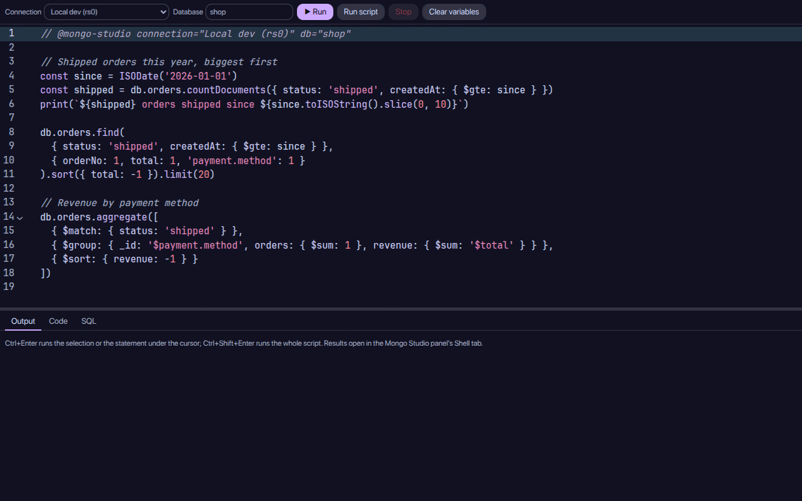
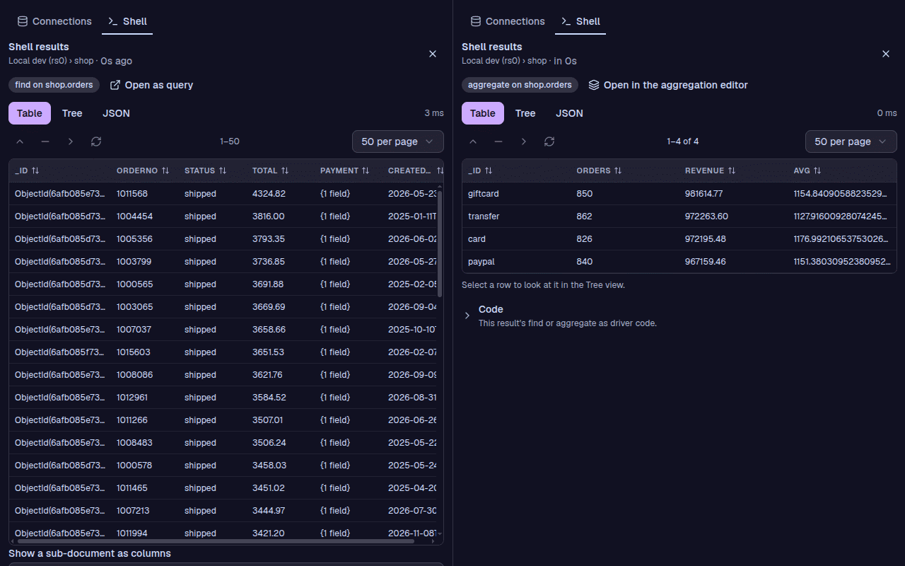

# Mongo Studio

A full MongoDB client inside [Orca](https://orca.dev): browse, query, aggregate, script and
administer your databases without leaving your editor. It is built from Orca's own components, so
it follows every Orca theme, light or dark.


## Install

In Orca, open **Settings → Plugins** and install **Mongo Studio** from the plugin directory. You
can also install it from its repository:

```sh
orca plugin install LeoBessin/orca-mongo-studio
```

Mongo Studio runs its own code in a background worker, so Orca asks you to approve it. It asks
for two permissions:

- `storage:own` keeps your connections, query history, saved pipelines and tasks.
- `secrets:own` keeps passwords and keys in your operating system's keyring.

Open **Mongo Studio** from Orca's right sidebar and add your first connection.

## Features

### Connections

- Standalone servers, replica sets, sharded clusters and `mongodb+srv` (Atlas).
- Sign-in methods: SCRAM, X.509, LDAP, Kerberos, AWS IAM and OIDC (browser sign-in, Azure, GCP or
  Kubernetes).
- TLS with certificates from a file or pasted PEM.
- SSH tunnels by password or key. The host key is pinned on first use.
- Edit a connection as a form or as a connection string; both stay in sync.
- **Test connection** checks DNS, SSH, TCP, TLS, the handshake, sign-in and permissions in turn.
  A failed step says what to try next.
- Groups, favourites and read-only connections.
- Import connection strings or MongoDB Compass exports. Exports never contain secrets.

### Browse and query

- A tree of databases, collections, views, time-series collections, GridFS buckets, indexes,
  users and roles, with counts, sizes and a filter.
- One tab per collection. The query bar takes filter, projection, sort, collation, skip and limit
  in mongo shell syntax.
- Tabs, their queries and pipelines, and the tree's open nodes come back when you return to the
  panel from another sidebar tab. Connections Orca closed while the panel was idle reopen by
  themselves, except ones that sign in through the browser.
- A **Query Builder** with nested AND/OR groups.
- Results as a **Table**, a **Tree** with BSON types, or **JSON** (relaxed or canonical Extended
  JSON). Results page through the open cursor, and the total is counted separately so the first
  page never waits for it.
- **Open** a document to see it whole, as a tree, Extended JSON or shell syntax, over the results;
  **Back to results** returns to them as they were. **Open in a tab** keeps it in a tab of its own
  next to its collection.
- Edit fields with inputs that match their BSON type, or edit whole documents. Insert, clone and
  delete documents, one at a time or in bulk.
- Per-collection query history and saved queries.

### Mongo Shell

- `.mongodb.js` files open in a shell editor with syntax highlighting and autocomplete for
  collections, fields, shell methods and operators.
- **Ctrl+Enter** runs the statement under the cursor. **Ctrl+Shift+Enter** runs the whole script.
- Scripts run like the classic mongo shell: `db.orders.findOne().total` and cursor loops need no
  `await`, and variables last between runs.
- Results open in the panel with the same Table, Tree and JSON views as a query.
- **Code** turns any find or aggregation into mongosh, Node.js, Python, Java, C#, PHP or Ruby.
- **SQL** translates a `SELECT` (with `WHERE`, `GROUP BY`, `JOIN`, `ORDER BY` and more) into
  MongoDB queries.



### Aggregation and performance

- A stage-by-stage **aggregation editor**. It previews each stage's input and output, and stages
  can be turned off, reordered or duplicated.
- Edit a pipeline as text, save it, or create a view from it. `$out` and `$merge` ask before they
  write.
- **Explain plans** for queries and pipelines: index use, documents examined against returned,
  in-memory sorts and the plan as a tree. Works with the classic and slot-based engines and with
  sharded clusters.



### Administration

- **Indexes:** every index with its size and usage. Create any kind of index: compound, text,
  geospatial, hashed, wildcard, TTL, partial, unique or hidden.
- **Validation:** edit the rules, check existing documents against them, or generate rules from a
  sample.
- **Collections and databases:** create plain, capped, time-series and clustered collections, or
  rename, clear and drop them. Includes the database profiler.
- **Users and roles:** create and edit users and custom roles.
- **Server:** live server status, replica set members with their lag, and current operations you
  can stop.
- **Schema Explorer:** samples a collection and shows every field with its types, how often it
  appears, and histograms of its values. It can export the result as a `$jsonSchema` validator or
  a JSON Schema.

### Data movement

- **Import** JSON, CSV/TSV (with type inference per column) and mongodump BSON, including whole
  dump folders.
- **Export** to JSON, CSV or BSON, from a collection, a query, a pipeline or a whole database.
- **Copy** collections or databases between connections, with their indexes and options.
- **Compare and sync** two collections, with a field-by-field view of each difference.
- **GridFS:** browse, preview, upload, download, rename and delete files.
- Long operations run in the background with progress, cancel and an error report.

### Workflow

- **Saved tasks:** save any import, export, copy, compare or sync and run it again in one click.
  Its last result is kept with it.
- **Read-only connections:** Mongo Studio refuses every write through them, in tabs and in the
  shell.
- **Confirmations** before anything is dropped, cleared or replaced. Each one names the namespace
  and its document count.
- Command palette entries and shortcuts that never clash with Orca's own:
  **Mod+Alt+Shift+T** shows saved tasks and **Mod+Alt+Shift+R** shows shell results.

## Security

- Passwords, keys, certificates and AWS secrets are stored only in the OS keyring, through Orca.
  The panel never receives them back; it only learns whether each one is saved.
- If Orca can't encrypt secrets on a machine, they stay in memory and are never written to disk.
  The panel says so.
- Credentials go to the driver as options, never inside a connection string.
- Shell scripts run in a separate context in the worker. Like mongosh, that context is not a
  security boundary, so run only scripts you trust.
- Mongo Studio collects no data and has no telemetry.

## Limitations

- **Kerberos** needs the native `kerberos` module, which installed plugins can't include. To use
  Kerberos, run Mongo Studio from a clone of this repository (see Development) after `kinit`.
- Through an **SSH tunnel**, Mongo Studio connects to the first host of a replica set only.
- The shell covers the common mongosh API. It doesn't include `rs.*`, `sh.*`, `load()`, change
  streams, sessions or transactions.
- **Read-only** mode is enforced by Mongo Studio, not by the server. For a hard guarantee, connect
  with a read-only database user.
- Imports and exports read and write paths on the computer running Orca. Downloads through the
  save dialog are limited to 64 MiB; larger files go to a path.
- Saved tasks run when you start them. Nothing runs on a schedule.

## Development

You need Node.js, Docker for the test databases, and the Orca desktop app.

```sh
npm install
npm run build             # bundle the worker, shell thread and panel into dist/
orca plugin dev load .    # load this folder into Orca (it prints an --approve fingerprint)
npm run build:watch       # rebuild on change
```

| Command | What it does |
|---|---|
| `npm run types` | Writes Orca's plugin typings into `.orca/types` (git-ignored); `typecheck` and `build` run it when needed |
| `npm run typecheck` | Type-checks the panel and the worker |
| `npm test` | Unit, protocol and panel tests (no database) |
| `npm run test:it` | Integration tests against the Docker databases |
| `npm run test:enterprise` | Kerberos and LDAP tests against MongoDB Enterprise |
| `npm run check` | Builds, renders the panel with `orca plugin check`, and validates the manifest |

Orca runs the bundles in `dist/`, even when it loads a development folder, so rebuild after
changing anything under `src/` and commit `dist/` with your change. The shell editor in
`src/editor/` loads as source. The panel is bundled because Orca loads at most 32 files at once
for an installed plugin.

The scripts run Orca's own CLI from the desktop app (`/usr/lib/orca-ide/app.asar.unpacked/out/cli/index.js`);
set `ORCA_CLI` to use another copy.

CI (`.github/workflows/ci.yml`) runs on every pull request and every push to `main`: typecheck,
`npm test`, a rebuild that fails if `dist/` differs from what is committed, `npm run check`, and
then the integration tests against the `test` databases. It takes the Orca CLI from the
pinned Orca release's `.deb` (`.github/actions/orca-cli`). The Kerberos and LDAP tests stay
local.

<details>
<summary>Test databases</summary>

```sh
# Replica set with demo data (shop, blog, analytics, types_zoo)
docker compose -f dev/docker-compose.yml up -d --wait
docker compose -f dev/docker-compose.yml exec mongo mongosh --quiet /seed/seed.mongodb.js
# mongodb://localhost:27017/?replicaSet=rs0&directConnection=true

# SCRAM (27019), TLS + X.509 (27018) and an SSH bastion (2222)
dev/test-env/make-certs.sh
docker compose -f dev/docker-compose.yml --profile test up -d --wait --build
dev/test-env/setup.sh

# Kerberos and LDAP: MongoDB Enterprise (27020), an MIT KDC and OpenLDAP
docker compose -f dev/docker-compose.yml --profile enterprise up -d --wait --build
dev/test-env/setup-enterprise.sh
```

</details>

<details>
<summary>Project layout</summary>

| Path | What |
|---|---|
| `src/panel.tsx`, `src/panel/` | The sidebar panel, built from Orca components |
| `src/worker.ts`, `src/worker/` | The worker: connections, secrets, the driver, SSH tunnels, jobs and the shell |
| `src/editor/` | The Mongo Shell editor (CodeMirror), with its Output, Code and SQL tabs |
| `src/shared/` | Code both sides use: connection model, URI parser, shell parser, Extended JSON, codegen, SQL translation |
| `src/protocol.ts` | The typed contract between the panel and the worker |
| `dist/` | The bundles Orca runs, built by `dev/build.mjs` |
| `test/` | Integration tests |
| `dev/` | Build scripts, Docker databases, seed data and test fixtures |
| `media/` | The cover and screenshots for the plugin directory |

</details>

<details>
<summary>Releasing</summary>

The Orca plugin directory lists the newest `vX.Y.Z` tag of this repository.

```sh
# raise "version" in orca-plugin.json and package.json, then:
npm run build && npm run check && npm test
git commit -am "Mongo Studio X.Y.Z"
git tag -a vX.Y.Z -m vX.Y.Z && git push origin main vX.Y.Z
```

The listing's status is at https://orca.dev/plugins/leobessin/orca-mongo-studio.

</details>

## License

[MIT](LICENSE)

Mongo Studio is an independent project. It is not affiliated with or endorsed by MongoDB, Inc.
MongoDB is a trademark of MongoDB, Inc.
