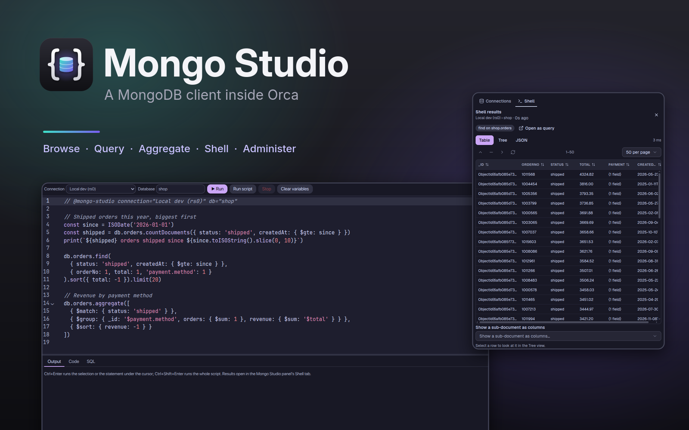

# Mongo Studio

A MongoDB client for Orca, built from Orca's own components so it follows every Orca theme. It
has no AI features.

Mongo Studio is an independent project. It is not affiliated with or endorsed by MongoDB, Inc.;
MongoDB is a trademark of MongoDB, Inc.



## Install

In Orca, find **Mongo Studio** in the plugin directory (Settings → Plugins), or install it from
its repository:

```sh
orca plugin install LeoBessin/orca-mongo-studio
```

It runs its own code in a worker (a full-access plugin), so Orca asks you to approve it. It asks
for `storage:own` (saved connections, history and tasks) and `secrets:own` (passwords and keys, in
the OS keyring). Kerberos (GSSAPI) sign-in needs a development install; see Known limits.

**Status:** all seven phases are done: connections and navigation, querying and data viewing,
shell and code, aggregation and explain, administration and schema, data movement, and workflow
(saved tasks, read-only connections, confirmations and keyboard shortcuts).

## What Phase 1 does

- **Connections**
  - Create, edit, clone and delete connections, and put them in groups.
  - Edit a connection as a form or as a connection string; both change the same settings.
  - Types: standalone, replica set, sharded (mongos list) and `mongodb+srv`.
  - Sign-in: SCRAM-SHA-1/256, X.509, LDAP (PLAIN), Kerberos (GSSAPI), AWS IAM (access keys or the
    AWS SDK chain) and OIDC (browser sign-in with PKCE, or Azure/GCP/Kubernetes identity).
  - TLS: CA and client certificate as a file path or pasted PEM, key password, and options to
    allow invalid host names or certificates.
  - SSH tunnel: password, or a private key with passphrase. The host key is pinned on first use
    and a changed key is refused.
  - Read preference, app name, timeouts, default database, and other URI options passed through.
- **Test connection.** Runs DNS, SSH, TCP, TLS, handshake, sign-in and permission checks in turn.
  Each step reports what it found, and a failed step gives a next step to try.
- **Tree.** Connections → databases → collections, views, time-series collections, GridFS buckets,
  indexes, users and custom roles. Nodes show counts and sizes. Selecting a node shows its details
  and definition. The tree has a filter and favourites, and each node can be refreshed.
- **Import and export.**
  - Import connection strings (one per line), Mongo Studio exports or MongoDB Compass exports.
  - Export saves through Orca's save dialog and never includes secrets. It also carries the saved
    tasks that use only the chosen connections (unless "Include saved tasks" is off), naming
    connections by name; on import they find the connections of that name, from the file first,
    then those already saved. A task whose connection can't be found, or is ambiguous, is left out
    and the import says why.
- **Palette commands:** New connection, Import connections, Export connections, Disconnect all.

## What Phase 2 does

- **Collection tabs.** Open a collection, view or time-series collection from the tree (the Open
  button, or Enter). Each opens as its own tab, so several can be open at once. Views are read
  only.
- **Query bar.** Filter, projection, sort, collation, skip and limit, in mongo shell syntax:
  unquoted keys, single quotes, regex literals, comments, trailing commas, and `ObjectId`,
  `ISODate`/`new Date`, `NumberInt`, `NumberLong`, `NumberDecimal`, `UUID`, `BinData`, `Timestamp`,
  `MinKey`/`MaxKey` and `RegExp`. It is parsed, never evaluated, and errors give the line and column.
- **Query Builder.** Field, operator and value rows in nested AND/OR groups. It applies to the
  filter, and loads back from a filter when the filter fits. "Add to query" on a field in the Tree
  view adds a row (in place of drag and drop).
- **Results.**
  - Pages of 20 to 500. The next page reads on from the open cursor. The total is counted
    separately with a time limit, so the first page never waits for it.
  - Table: one column per top-level field, sorting by column, multiple selection, and "Show a
    sub-document as columns".
  - Tree: documents → fields, each with its BSON type.
  - JSON: relaxed or canonical Extended JSON.
- **Editing.**
  - Field editor: an input that fits the field's BSON type, with the type as its own choice. It
    covers ObjectId, Date, Decimal128, Int64, Int32, Double, Binary, UUID, regex, Timestamp,
    MinKey/MaxKey, null, boolean, string, JavaScript, and documents and arrays.
  - Add and remove fields.
  - Document editor: shell syntax or canonical Extended JSON.
  - Insert, clone and delete, including bulk delete of the selected rows. Deleting asks first and
    names the namespace and document count.
- **History and saved queries.** The last 50 queries run on each collection, and named saved
  queries, are kept per connection.

## What Phase 3 does

- **The shell.** A `.mongodb.js` file opens in the Mongo Shell editor. Create one with
  "Mongo Studio: New shell script" in the + menu or the command palette.
  - The first line names the connection and database, so the file opens ready to run:
    `// @mongo-studio connection="Local dev" db="shop"`. The pickers above the editor change it.
  - Ctrl+Enter runs the selection or the statement under the cursor. Ctrl+Shift+Enter runs the
    whole script. Stop ends a running script, even an endless loop.
  - Scripts run like the legacy mongo shell: database calls return their results, so
    `db.orders.findOne().total`, `forEach` and `for … of` over a cursor need no `await` (it still
    works). Variables last between runs until "Clear variables". `use`, `show dbs`,
    `show collections`, `print`, `printjson`, `sleep` and the BSON constructors work.
  - Output appears under the editor, with each statement's value and the line it came from. An
    error stops the script and is underlined at its line.
  - Cursors, arrays of documents and documents open in the panel's **Shell** tab with the same
    Table, Tree and JSON views and paging as a query. A find opens as a query in its collection's
    tab with "Open as query".
  - Autocomplete: collections, fields sampled from the collection, shell methods, and the operators
    that fit where the cursor is (query, update, stage, accumulator, expression or projection).
- **Code generation.** The Code tab under the editor, and a Code section on collection tabs and
  shell results, turn a find or aggregate into code for mongosh, Node.js, Python, Java, C#, PHP or
  Ruby. Every BSON type keeps its type in the generated code.
- **SQL → MQL.** The SQL tab translates a SELECT into a statement you can run or insert into the
  script: WHERE (with IN, BETWEEN, LIKE, IS NULL), GROUP BY with COUNT/SUM/AVG/MIN/MAX and HAVING,
  ORDER BY, LIMIT/OFFSET, DISTINCT, and INNER/LEFT JOIN as `$lookup`. Notes say where MongoDB
  differs from SQL. Anything it can't translate faithfully is refused with the position.

## What Phase 4 does

- **Aggregation editor.** "Aggregate" on a collection, view or time-series collection in the tree
  opens its aggregation tab. A collection tab's layers button opens it with the query bar's
  filter, sort, skip, limit and projection as stages, and a shell aggregate result opens there with
  "Open in the aggregation editor".
  - Stages are listed in a table. Add a stage after the selected one, move it up or down, turn it
    off and on, duplicate it or remove it (Orca has no drag and drop, so these are buttons).
  - The selected stage is edited in shell syntax, starting from a template for its operator. The
    preview shows its **input** (the stages before it) and its **output**, 5 to 100 documents
    each. Ctrl+Enter or "Update preview" reads them again.
  - "Edit as text" shows the whole pipeline as one array; applying it replaces the stages.
  - Run pages the results like a query, with Table, Tree and JSON views and a count. "Allow disk
    use" applies to the preview, the run and explain.
  - A pipeline ending in `$out` or `$merge` asks first and names the collection it writes to. It
    runs once: never in a preview, a count or a page, and explain only plans it.
  - "Create a view" makes a view on the collection from the stages that are on, and offers to
    open it.
  - Saved pipelines keep each stage as typed, off ones included, per collection.
  - The Code section turns the pipeline into mongosh, Node.js, Python, Java, C#, PHP or Ruby.
- **Explain plans** for the query in a collection tab (the gauge button) and for a pipeline:
  - Verbosity: queryPlanner (plan only), executionStats or allPlansExecution.
  - Visual: the plan (indexes or collection scan), documents returned and examined, index keys
    examined, time, rejected plans; warnings for collection scans, in-memory sorts, spills to disk
    and a high examined-to-returned ratio; and the plan as a tree with each stage's own numbers.
    Selecting a stage shows its details (bounds, filter, sort pattern, …).
  - It reads the classic engine, the slot-based engine of MongoDB 7 and 8, pipelines with a
    `$cursor` stage, and sharded plans (one branch per shard).
  - Raw: the server's whole answer as JSON.
- **Shell:** `cursor.explain(verbosity)`, `db.coll.explain(verbosity).find(…)` (with `.finish()`
  to read it in a script), `.aggregate(…)`, `.count(…)` and `.distinct(…)`.

## What Phase 5 does

Each of these is a tab next to the collection tabs, opened from the tree's action bar.

- **Manage a collection** (gear button on a collection or view, or on a collection tab;
  "Manage indexes" on the Indexes node or an index):
  - Overview: documents, sizes, indexes, capped limits, clustering, time-series fields and expiry,
    and the creation options.
  - **Index manager.** Every index with its key, kind, size and use count (`$indexStats`), and
    builds in progress. New index: field rows of ascending, descending, text, 2dsphere, 2d, hashed
    or wildcard (`$**`, on all fields or under one), with unique, sparse, hidden, TTL, partial
    filter, collation, wildcard projection, text weights and languages, and 2d bits/min/max. The
    form checks what the server would refuse and shows the mongosh command. Hide or unhide an
    index, change a TTL, drop an index (after a confirmation).
  - **Validation.** The rules in shell syntax with level and action; "Check documents" counts the
    documents that break them (and names the first); "From the schema" builds rules from a sample.
  - Rename (also to another database, optionally replacing the target), make capped, delete all
    documents, drop. Clearing and dropping ask first, naming the namespace and document count.
- **Database** ("Manage" on a database; the + button on a connection makes a new one):
  statistics and collections; create a collection that is plain, capped (size, most documents),
  time series (time and meta fields, granularity, expiry) or clustered (expiry), with a validator
  and collation, showing the mongosh command; the **profiler** (level, slow threshold, sample rate)
  and its newest entries with filters by operation, duration and collection; drop the database,
  after typing its name. `admin`, `local` and `config` are never dropped.
- **Users and roles** ("Users" on a database, or the Users and Roles nodes): users with their
  roles and sign-in mechanisms, custom roles with their privileges. Create and edit users
  (password, roles from the built-in and custom lists or typed, custom data, SCRAM mechanisms) and
  roles (privileges in shell syntax, inherited roles); drop either after a confirmation. A typed
  password lives only in the open form.
- **Server** (gauge button on a connected connection): serverStatus in sections (server,
  connections, operations, network, memory and WiredTiger cache, replication, asserts), rates per
  second between readings, replica set members with their lag, and a live mode that reads every
  5 s. **Current operations** with filters (namespace, running time, idle connections, the
  server's own work), details, and Stop (killOp) after a confirmation.
- **Schema Explorer** (chart button on a collection or view): samples 100 to 10,000 documents
  (`$sample`, after an optional filter) and shows every field as a tree, arrays' elements included,
  with its types and how often it is there. A field shows its type split, a histogram of numbers or
  dates, its most common strings, lengths and array sizes. The sample's shape exports as a MongoDB
  `$jsonSchema` validator (sent to the Manage tab with "Use as validator") or a JSON Schema
  (draft 2020-12), saved with Save as file.

## What Phase 6 does

Data moves as **jobs** in the worker: a tab starts one and follows its progress (documents or
bytes, the current step, Cancel), then lists the first 50 errors with the record or namespace they
came from. Files come in as pasted text or a path the worker reads, and go out through Orca's save
dialog (up to 64 MiB) or to a path the worker writes (as `<name>.part`, renamed when complete).

- **Import** (upload button on a database, a collection or a collection tab):
  - JSON: an array, one document per line (mongoexport), or documents one after another;
    relaxed or canonical Extended JSON.
  - CSV and TSV: a preview reads the columns and infers each one's type (Int32, Int64, Double,
    Decimal128, Boolean, Date, ObjectId, Extended JSON or String; numbers with leading zeros stay
    text). Change any column's field (dotted fields make sub-documents) or type, or skip it.
    Headers typed as mongoimport writes them (`age.int32()`) are read.
  - BSON: a mongodump `.bson` file, or a dump folder (one collection per file), `.gz` included;
    `.metadata.json` brings back indexes, collection options and views.
  - Insert, replace by `_id`, or merge fields by `_id`; drop the collection first (asked, with
    its count); stop at the first error.
- **Export** (download button on a collection, a database, a collection tab with its query, or an
  aggregation tab with its pipeline): JSON (lines or array, relaxed or canonical, indented),
  CSV (columns picked from sampled fields, in any order; arrays and sub-documents as Extended JSON),
  BSON with `.metadata.json` as mongodump writes it. A whole database goes to a folder.
- **Copy and paste** (copy button on a collection, a database or selected documents; Paste on a
  connection, database or collection, on any connection): opens the Export tab set to "Another
  collection". Copies keep every BSON type, and can copy indexes and collection options (capped,
  validation, collation, time series). A database copy recreates views and copies three
  collections at a time; a failure in one stops the rest. Insert, replace or merge
  by `_id`, or drop the target first (asked, with its count).
- **Compare and sync** (branch button on a collection or a collection tab): two collections on
  the same or different connections, matched by `_id`, with a filter for both sides, fields to
  leave out and whether field order counts. Counts of documents that are the same, differ, or are
  only on one side; the `_id`s of each kind; a pair's differences field by field. Sync makes one
  side like the other (insert, replace, delete, each optional), asked first with the counts.
- **GridFS** ("Browse files" on a bucket): files by name, newest first, paged; details, chunk
  check and a text preview of the first 64 KB; download (save dialog or a path), upload (a path or
  pasted text, with content type and metadata), rename, delete (asked first).

## What Phase 7 does

- **Saved tasks.** An import (from a path), an export, a copy, a compare or a sync is saved from its
  tab with "Save as task", with every option it was set up with. The **Tasks** tab (rocket button
  on the Connections tab, or "Mongo Studio: Show saved tasks", Ctrl+Alt+Shift+T, Cmd+Option+Shift+T
  on macOS) lists them with their last run. Select one to:
  - Run it. It runs exactly as its tab would, with the same progress, errors and Save button. A
    run that drops a collection, replaces collections or syncs into one asks first, naming the
    collection and the documents it holds now. Each run's outcome (done, failed or cancelled, how
    long, and what it did) is kept with the task.
  - Open it in its tab, change it there and press "Update", or save it as a new task.
  - Rename, duplicate or delete it.

  Tasks run when you press Run. Nothing runs on a schedule: Orca's automations start AI agents,
  which this plugin doesn't use, and Orca stops the plugin's worker when it is idle. Deleting a
  connection deletes the tasks that use it.
- **Read-only connections.** "Read only" in a connection's settings makes the worker refuse every
  change through it, before connecting: document edits, inserts and deletes, `$out`/`$merge`
  pipelines, views, indexes, validation, rename, clear and drop, databases, the profiler, users and
  roles, stopping operations, imports, copies and syncs into it, and GridFS uploads, renames and
  deletes. In the shell, reads work as usual and each write is refused at its line; commands sent
  with `db.runCommand` pass only when they are known to read. Exports, compares and copies *from*
  a read-only connection still work. Its tree row and every tab of it say "read only", and a saved
  task that writes to it can't run. Its tabs leave out what would write: document editing; new,
  hidden, dropped or TTL-changed indexes; saving validation rules (checking documents against
  rules still works); rename, clear and drop; creating collections and dropping the database;
  profiler settings (its entries can still be read); user and role editing; stopping operations;
  imports; GridFS uploads, renames and deletes.
- **Confirmations** before anything is removed or replaced name the namespace and its document
  count: dropping or clearing a collection, dropping a database (collections and documents),
  renaming over a collection that exists, `$out`/`$merge` into a collection, dropping an index,
  bulk deletes, imports and copies that drop first, syncs, and saved tasks that do any of these.
- **Keyboard shortcuts** never take one of Orca's own: "Show saved tasks" is Mod+Alt+Shift+T and
  "Show shell results" is Mod+Alt+Shift+R. In the shell editor, CodeMirror's fold shortcuts, which
  are Orca's tab-switching keys, are left out. A test checks every shortcut against Orca's
  defaults (`src/shared/orca-keys.ts`, written by `dev/orca-keys.mjs`).

### Size limits

Orca refuses a panel request or answer past 1 MiB, 10,000 objects or arrays, or 100 levels deep.
In canonical Extended JSON every number is an object, so pages are sized in Orca's own measure
(`src/shared/host-size.ts`).

- A page can stop before the page size. Next page goes on from there.
- Long strings, big arrays and binary data show a preview. Editing always loads the whole document.
- Documents too big for one request are edited in the shell. The editor says why.

## Where things are

| Path | What |
|---|---|
| `src/panel.tsx`, `src/panel/` | The right-sidebar panel: Orca components only |
| `src/worker.ts`, `src/worker/` | The worker: saved connections, secrets, MongoClients, SSH tunnels, diagnostics, tree loading |
| `src/protocol.ts` | The typed panel ↔ worker contract |
| `src/panel/collection-*.tsx`, `results-view.tsx`, `editors-view.tsx` | Collection tabs: query bar, Query Builder, results, editors, history |
| `src/worker/query.ts` | Query cursors and pages, counts, document writes, history and saved queries |
| `src/editor/` | The Mongo Shell custom editor: CodeMirror, output, Code and SQL tabs |
| `src/editor/vendor/` | CodeMirror bundled into one file by `dev/build-codemirror.mjs` |
| `src/worker/shell.ts`, `shell-thread.mjs` | Shell sessions: the script thread and the database calls it makes |
| `src/panel/shell-*.ts(x)` | The panel's Shell tab and the Code section |
| `src/shared/js-scan.ts`, `shell-prepare.ts`, `shell-call.ts`, `shell-vocab.ts` | Statements, autocomplete places, statement → operation, shell vocabulary |
| `src/shared/codegen.ts`, `sql-to-mql.ts` | Code generation and SQL translation |
| `src/panel/aggregate-*.ts(x)`, `src/shared/pipeline.ts` | Aggregation tabs and the stage model |
| `src/panel/explain-*.ts(x)`, `src/shared/explain.ts` | Explain sections and the explain reader |
| `src/worker/aggregate.ts` | Stage previews, explain, views from a pipeline, saved pipelines |
| `src/panel/admin-*.ts(x)` | Administration tabs: shared state, notices, drawing a tab by kind |
| `src/panel/manage-*`, `database-*`, `users-*`, `server-*`, `schema-*` | The Manage, Database, Users and roles, Server and Schema tabs |
| `src/worker/admin.ts`, `users.ts`, `server.ts`, `schema.ts` | Indexes, collections, databases, profiler; users and roles; server status and operations; schema sampling |
| `src/shared/index-spec.ts`, `schema.ts` | The index form, and the schema analysis, histograms and JSON Schema export |
| `src/panel/import-*`, `export-*`, `compare-*`, `gridfs-*`, `data-state.ts`, `job-view.tsx` | The Import, Export/Copy, Compare and GridFS tabs; following jobs, downloads, the clipboard |
| `src/worker/jobs.ts`, `import.ts`, `export.ts`, `writer.ts`, `compare.ts`, `gridfs.ts` | Jobs, uploads and file sinks; import, export and copy, batched writes, compare and sync, GridFS |
| `src/panel/tasks-*`, `src/worker/tasks.ts`, `src/shared/tasks.ts` | The Tasks tab and "Save as task"; task storage; task requests, confirmations and summaries |
| `src/shared/read-only.ts` | What a read-only connection lets through: commands, pipelines and shell calls |
| `src/shared/keys.ts`, `orca-keys.ts` | Shortcut notations, and Orca's default shortcuts (from `dev/orca-keys.mjs`) |
| `src/shared/csv.ts`, `json-records.ts`, `compare.ts`, `base64.ts` | CSV reading, types and writing; splitting JSON into documents; document comparison; base64 for downloads |
| `src/shared/` | Pure code both sides use: connection model, URI parser/builder, import/export, tree keys, the shell literal parser, Extended JSON views, the Query Builder and field-editor models |
| `dist/` | What the manifest runs, generated by `npm run build` and committed: the worker (`main`), the shell thread and the panel |
| `media/` | The cover and screenshots for the plugin directory |
| `test/` | Integration tests against the docker databases |
| `dev/` | Docker databases, seed data and test fixtures |

## Security

- Passwords, keys, pasted certificates and AWS secrets are stored only through `secrets:own`
  (the OS keyring). The worker never sends them back to the panel, which only learns whether
  each secret is saved.
- When Orca reports that it cannot encrypt secrets on a machine, secrets stay in the worker's
  memory and are never written. The panel says so.
- Credentials go to the driver as options, never inside a URI string. Exports never contain
  secrets.

The plugin asks for `storage:own` and `secrets:own` only.

Shell scripts run in a worker thread of the plugin's worker, in a separate JavaScript context
that offers only the shell's API. Like mongosh, that context is not a security boundary: run only
scripts you trust. A script runs only when you press Run.

## Develop

```sh
npm install
npm run build            # bundles the worker, shell thread and panel into dist/
orca plugin dev load .   # Orca prints the access it needs and an --approve fingerprint
npm run build:watch      # while editing anything under src/ but the shell editor
npm run typecheck
npm test                 # unit, protocol and panel tests (no database)
dev/shots.sh             # screenshots of every view, light and dark (Orca's window must be hidden)
npm run check            # orca plugin check + validate
node dev/build-codemirror.mjs   # after upgrading CodeMirror: rebuilds src/editor/vendor/
ELECTRON_RUN_AS_NODE=1 node dev/orca-keys.mjs   # after upgrading Orca: Orca's default shortcuts
```

The manifest points at the bundles (`main` is `dist/worker.mjs`, the panel's entry
`dist/panel.js`), so Orca runs them even in a development folder: rebuild after changing code
under `src/`, and commit `dist/` with the change. The panel is bundled because Orca serves an
installed plugin's frame at most 32 requests at a time, fewer than the panel's ~60 modules. The
shell editor (`src/editor/`, 15 files) loads as source. The test scripts
run through `dev/with-source-main.mjs`, which points `main` at `src/worker.ts` while the tests
run, because `orca plugin test` lets only files reached from `main` import npm packages.

If the `orca` command fails on this machine, run
`ELECTRON_RUN_AS_NODE=1 node /usr/lib/orca-ide/app.asar.unpacked/out/cli/index.js` instead; the
npm scripts already do.

### Release

The plugin directory lists the newest `vX.Y.Z` tag of this repository (it has the `orca-plugin`
topic).

```sh
# raise "version" in orca-plugin.json (and package.json), then:
npm run build && npm run check && npm test
git commit -am "Mongo Studio X.Y.Z"
git tag -a vX.Y.Z -m vX.Y.Z && git push origin main vX.Y.Z
```

The listing is at https://orca.dev/plugins/leobessin/orca-mongo-studio.

### Databases

```sh
# Dev replica set with seeded demo data (shop, blog, analytics, types_zoo)
docker compose -f dev/docker-compose.yml up -d --wait
docker compose -f dev/docker-compose.yml exec mongo mongosh --quiet /seed/seed.mongodb.js
# mongodb://localhost:27017/?replicaSet=rs0&directConnection=true

# Integration tests: SCRAM (27019), TLS + X.509 (27018), SSH bastion (2222), plus querying and
# editing on the seeded dev replica set above
dev/test-env/make-certs.sh
docker compose -f dev/docker-compose.yml --profile test up -d --wait --build
dev/test-env/setup.sh
npm run test:it

# Kerberos and LDAP: MongoDB Enterprise (27020), an MIT KDC and OpenLDAP
docker compose -f dev/docker-compose.yml --profile enterprise up -d --wait --build
dev/test-env/setup-enterprise.sh
npm run test:enterprise
```

## Known limits

- Through an SSH tunnel, the plugin connects to the first database host only, since the driver
  can't reach the other replica set members it discovers.
- Kerberos uses the ticket cache on your computer, so run `kinit` first. It needs the native
  `kerberos` module, which an installed plugin can't ship (the plugin directory refuses native
  binaries). In an installed copy, Kerberos sign-in fails with a message saying so; load the
  repository as a development folder after `npm install` to use it.
- The shell covers the common mongosh API, not all of it: no `rs.*`, `sh.*`, `load()`, `watch`,
  sessions or transactions. `it` is not needed, since results page in the panel. Only the newest
  run's results stay open in the panel.
- A stage preview runs the stages before it on the whole collection, then keeps the first
  documents. A slow `$group` or `$sort` early in a big pipeline makes the preview slow too (it
  stops after 30 s).
- Paging a pipeline's results past the open cursor runs the pipeline again with `$skip`.
- Orca has no chart component, so the Schema Explorer draws distributions as progress bars and
  tables with text bars. Histograms are built from up to 5,000 values per field and scaled.
- Live server status refreshes while the tab stays open; it waits in the worker between readings,
  since a components panel has no timers.
- Imports and exports read and write paths on this computer only. mongodump's `--archive`
  format is not read; give the dump folder instead. CSV dates are ISO 8601 or milliseconds (no
  custom layouts), and mongoimport's `binary()` and `date(layout)` header types are read as
  inferred types.
- Compare matches documents by `_id` only, and lists at most 1,000 `_id`s of each kind (the
  counts are complete). Sync replaces whole documents, fields left out of the comparison included.
- Saved tasks run on demand only, while Orca is open. An import task reads a path; pasted text
  can't be saved. A sync task's options show in the Compare tab after a comparison.
- Read only is enforced by Mongo Studio, not by the server: a user with write rights can still
  write through other tools. Give the connection a read-only database user for that.
- The save dialog takes at most 64 MiB, and the worker keeps a download in memory until the
  panel has fetched it; bigger exports and files go to a path.

## License

[MIT](LICENSE)
